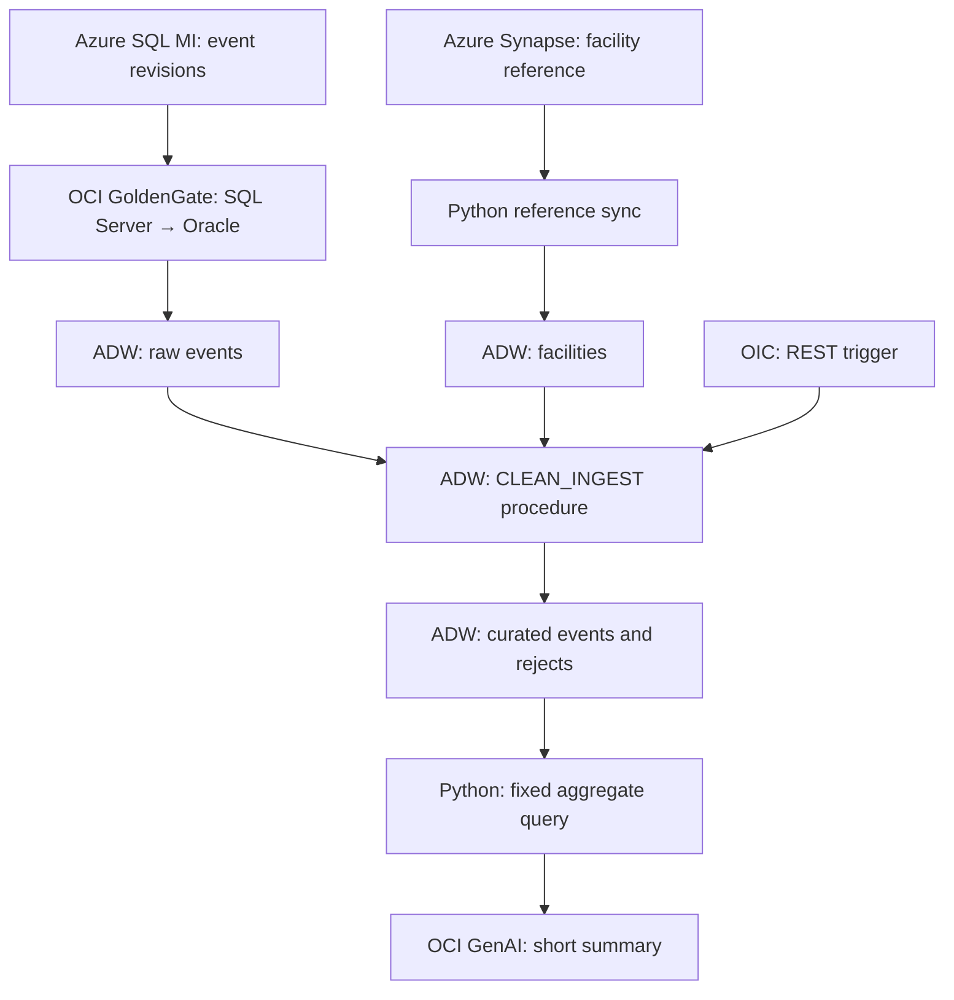

# What runs where

Azure VNet `10.50.0.0/16` and OCI VCN `10.60.0.0/16` use two static-route IPSec tunnels. Azure SQL MI uses its private VNet endpoint in Proxy mode, port 1433. Synapse uses a SQL private endpoint. OCI DNS forwards Azure database names to an Azure Private DNS Resolver over the VPN.

ADW, both GoldenGate deployments, the Python runner, and OIC's outbound endpoint use an OCI private subnet. ADW allows server-authenticated TLS so Python and GoldenGate can use the TLS descriptor without distributing client wallets. OIC can use the ADW adapter's mTLS wallet. Both paths still verify certificates. OCI Bastion provides temporary access to the runner; it has no public IP.

OIC's REST endpoint remains public with an IP allowlist for the operator and OCI NAT address. The sample permits outbound access from the OCI service subnet. Synapse's required ADLS account is authenticated but has a public network endpoint; it holds no sample records. Split service subnets, tighten egress, and add ADLS private endpoints before expanding this lab.

## Reference versus adaptation

| Public reference | This lab |
| --- | --- |
| GoldenGate, Oracle staging database, ADW | Two GoldenGate deployments, ADW raw schema and curated schema |
| OCI Data Integration | Oracle Integration 3 invokes a PL/SQL cleanup package |
| Multiple external sources and on-premises connectivity | Azure SQL MI and Azure Synapse only |
| OCI government-region deployment | Commercial Azure/OCI regions chosen by the operator |
| Business analytics | Fixed aggregate query plus optional OCI GenAI summary |

Oracle's support matrix lists Azure SQL Database and Azure Synapse as GoldenGate targets, not the source used here. Azure SQL **Managed Instance** is the CDC source. Synapse reference data is copied separately by Python.

## Data semantics

`row_id` is the immutable revision key; `(revision, row_id)` decides the latest version of each `event_id`. The source is append-only in this example. Cleanup trims and uppercases categories, validates dates and visit counts, joins facilities, and separates invalid latest records. A tombstone removes an event; a newer correction can restore it.

The PL/SQL procedure atomically rebuilds the small curated snapshot. A lock serializes cleanup and reference updates. Its run ledger makes a repeated `run_id` return the original result; use a new ID for a new snapshot. Python's offline demo exercises equivalent rules in SQLite; it does not emulate GoldenGate or OIC. At larger volumes, replace the full refresh with a measured incremental design.

GenAI sees only ward/service counts from a fixed SQL view. It never receives raw records or executes generated SQL. There are no real patient records, and these counts cannot support population-rate or medical conclusions.
